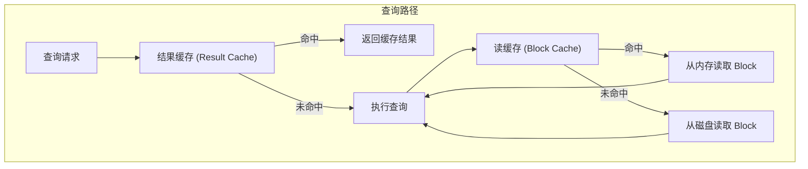
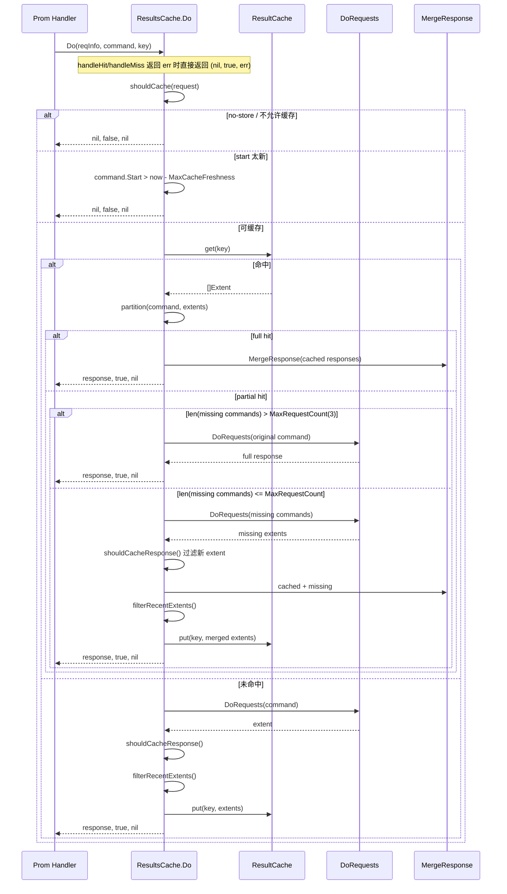
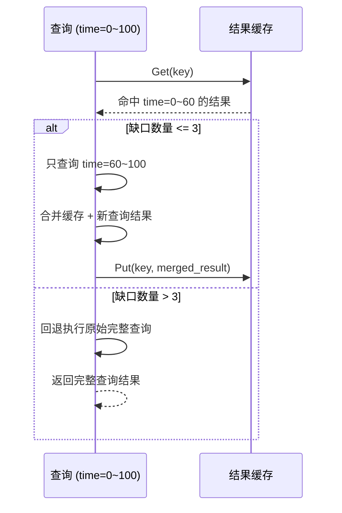
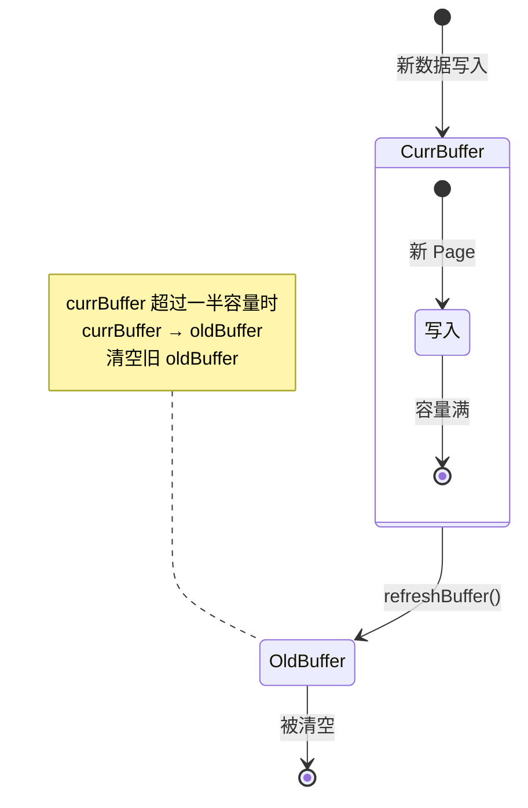

# Module 23: 查询缓存深度审计报告（庖丁解牛版）

> 基线：openGemini `origin/docs/spec-md-chinese` @ `9717d662`（2026-04-11，main + 19 commits）。

> openGemini 的查询缓存分为两大类：**结果缓存**（PromQL 查询结果）和**读缓存**（磁盘 Block/Page 级别）；读缓存按用途又分为 Data 与 Meta 两级。

---

## 1. 两层缓存架构



---

## 2. 结果缓存（PromQL 层）

**代码位置**：`lib/resultcache/`, `lib/util/lifted/influx/httpd/results_cache.go`

### 2.1 缓存策略

```go
type ResultCache interface {
    Get(key string) ([]byte, bool)   // 查找
    Put(key string, value []byte)    // 写入
}
```

**缓存 Key**：`mst:db:rp:cmd:step:startBucket`

```go
func generateCacheKey(command *promql2influxql.PromCommand, mst string, interval time.Duration) string {
	currentInterval := command.Start.UnixNano() / int64(interval)
	var builder strings.Builder
	builder.WriteString(mst)
	builder.WriteString(":")
	builder.WriteString(command.Database)
	builder.WriteString(":")
	builder.WriteString(command.RetentionPolicy)
	builder.WriteString(":")
	builder.WriteString(command.Cmd)
	builder.WriteString(":")
	builder.WriteString(command.Step.String())
	builder.WriteString(":")
	builder.WriteString(strconv.FormatInt(currentInterval, 10))

	return builder.String()
}
```

**具体例子**：

```
mst = "cpu"
db = "prom"
rp = "autogen"
cmd = "rate(cpu_usage[5m])"
step = "10s"
SplitQueriesByInterval = 5m
start = 1970-01-01 00:08:00

key = cpu:prom:autogen:rate(cpu_usage[5m]):10s:1
```

`startBucket` 不是原始 start 时间，而是 `command.Start.UnixNano() / SplitQueriesByInterval` 的整数桶号。这样同一时间桶内的相同 PromQL 请求会路由到同一个结果缓存 key。

**淘汰策略**：LRU（Least Recently Used）

**TTL 机制**：惰性检查 — Get 时检查是否过期，无后台清理

**缓存类型**：`ResultCacheType` 定义了 `MEM_CACHE` 与 `FILE_CACHE`，但 `NewResultCache` 只为 `MEM_CACHE` 返回 `MemCacheAdapter`，其他类型返回 nil（`lib/resultcache/cache_factory.go:30-38`）。

### 2.2 ResultsCache.Do 真实流程



**核心代码讲解**：

```go
func (rc *ResultsCache) Do(reqInfo *RequestInfo, command *promql2influxql.PromCommand, key string) (*promql2influxql.PromQueryResponse, bool, error) {
	rc.Logger.Debug("result cache key", zap.String("key", key))
	r := reqInfo.r
	if !shouldCache(r) {
		rc.Logger.Info("not enable cache", zap.String(cacheControlHeader, noStoreValue))
		return nil, false, nil
	}

	response := &promql2influxql.PromQueryResponse{}
	var extents []promql2influxql.Extent
	var err error

	maxCacheFreshness := rc.MaxCacheFreshness
	maxCacheTime := model.Now().Add(-maxCacheFreshness).UnixNano()
	if command.Start.UnixNano() > maxCacheTime {
		rc.Logger.Debug("cache miss", zap.Int64("start time", command.Start.UnixNano()))
		return nil, false, nil
	}

	fullHit := false
	cached, ok := rc.get(key)
	if ok {
		rc.Logger.Debug("hit result cache", zap.String("key", key))
		response, extents, err = rc.handleHit(reqInfo, command, cached, maxCacheTime, &fullHit)
	} else {
		rc.Logger.Debug("miss result cache", zap.String("key", key))
		response, extents, err = rc.handleMiss(reqInfo, command, maxCacheTime)
	}
	if err != nil {
		return nil, true, err
	}
	if fullHit {
		return response, true, nil
	}

	extents = rc.filterRecentExtents(extents, command.Step.Nanoseconds(), maxCacheFreshness)
	if len(extents) > 0 {
		rc.put(key, extents)
	}

	return response, true, nil
}
```

**逐行解释**：
- `shouldCache(reqInfo.r)`：遵守 HTTP cache-control，遇到 no-store 等场景直接绕过缓存
- `maxCacheTime`：用 `MaxCacheFreshness` 避免缓存过新的数据
- `rc.get(key)`：读取并反序列化 `CachedResponse`，同时校验响应内的 key
- `handleHit()`：把已有 Extent 与请求范围做 `partition()`；缺口数量不超过 `MaxRequestCount(3)` 时才逐段补查并合并，超过时回退执行原始完整查询
- `handleMiss()`：完整执行一次查询，并把结果作为一个 Extent 返回
- `shouldCacheResponse()`：检查 PromQL `@` modifier 是否落在 `maxCacheTime` 之内，以及是否存在负 `offset`（不检查新鲜度本身）
- `filterRecentExtents()`：裁掉太新的区间、空响应和无效响应
- `rc.put(key, extents)`：序列化 `CachedResponse{Key, Extents}` 写入底层 `ResultCache`

### 2.3 部分命中



**通俗解释**：
如果你查询"最近 100 分钟的数据"，缓存中有"前 60 分钟"的结果，系统只查询"后 40 分钟"，然后合并。这样避免了重复计算。

---

## 3. 读缓存（Block/Page 层）

**代码位置**：`lib/readcache/`

### 3.1 结构

```go
// lib/readcache/blockcache.go
type blockCache struct {
	blocks     []mapLruCache
	blockSize  int   // how much block
	blockLimit int64 // per block max size
	hashPool   *sync.Pool
	hitRecord  cacheStat
	recordHit  func(isHit bool)
}

// lib/readcache/maplru.go
type lruCache struct {
	lock       sync.RWMutex
	limitSize  int64
	bufferSize int64
	oldBuffer  *buffer
	currBuffer *buffer
	bufPool    *sync.Pool
}
```

### 3.2 代际淘汰（Generational Eviction）



**通俗解释**：
读缓存就像"两代仓库"。新数据先进"当前仓库"，当前仓库满了，就把"当前仓库"变成"上一代仓库"，同时清空旧的"上一代仓库"。查询时先查"当前仓库"，没找到再查"上一代仓库"。

### 3.3 缓存 Key

```
格式：filePath&&offset 或 filePath&&blockId
示例：/data/db0/0/cpu_0001/00000001-0000-00000001.tssp&&1048576
```

### 3.4 配置

```
Meta Cache: 默认内存的 3%（uint64Limit 夹在 8GB~512GB）
Data Cache: 默认内存的 10%（uint64Limit 夹在 8GB~512GB）
说明：Meta 缓存默认开启；enable-data-cache 样例默认 0（关闭）
```

---

## 4. 总结

| 缓存层 | 粒度 | 淘汰策略 | TTL |
|--------|------|---------|-----|
| 结果缓存 | 查询结果 | LRU | 惰性检查 |
| 读 Data Cache（Block/Page） | Block/Page | 代际淘汰 | 无（按容量） |
| 读 Meta Cache（元数据页缓存） | 文件元数据 | 代际淘汰 | 无（按容量） |

| 设计 | 效果 |
|------|------|
| 结果缓存部分命中 | 避免重复计算 |
| 256 分片读缓存 | 减少锁竞争 |
| 代际淘汰 | 简单高效，无链表维护 |
| 引用计数 Page | 安全并发访问 |
